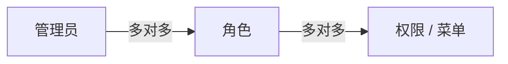

# LaravelVueAdmin

轻量的 Laravel + Vue 3 后台管理系统，内置基于 JWT 的 RBAC 权限模型（管理员 / 角色 / 权限菜单）与站点设置、用户管理。

## 特性

- JWT 认证（`php-open-source-saver/jwt-auth`），支持登录、刷新、退出、修改密码与个人资料
- RBAC：管理员、角色、权限（菜单树）三级授权，由中间件校验接口权限
- 管理员启用 / 停用与软删除，停用账号由中间件拦截
- 权限菜单树：后台按当前管理员权限动态返回菜单
- 站点设置：后台维护，前台通过公开接口读取
- 登录接口限流（每分钟 5 次）
- 前后台共用一个 Vue SPA（Vue Router），UI 使用 Element Plus

## 技术栈

| 层级 | 技术 |
| --- | --- |
| 后端 | PHP ^8.4、Laravel ^13、JWT Auth、Sanctum |
| 前端 | Vue 3、Vue Router 4、Element Plus、Tailwind CSS 4、Vite |
| 测试 | PHPUnit 12 |

## 目录结构

```
app/
    Console/Commands/CreateDeveloperAdmin.php   创建初始开发者管理员
    Console/Commands/ChangeDeveloperAdminPassword.php 修改开发者管理员密码
  Http/Controllers/Admin/                     后台控制器
  Http/Controllers/Web/                       前台控制器
  Http/Middleware/                            权限校验、管理员状态校验
  Models/                                     Admin / Role / Permission / Setting
database/                                     迁移与 Seeder（权限、角色、管理员、设置）
resources/js/                                 Vue 前端（router.js、api.js、components/admin）
routes/api.php                                API 路由（/api/web/*、/api/admin/*）
routes/web.php                                SPA 入口路由
tests/Feature/                                认证、管理员、角色权限、中间件测试
```

## 环境要求

- PHP >= 8.4（含 `openssl`、`pdo`、`mbstring` 等常规扩展）
- Composer 2
- Node.js 20+ 与 npm
- MySQL / MariaDB 等 Laravel 支持的数据库

## 开发环境

### 1. 安装依赖

```bash
composer install
npm install
```

### 2. 配置环境

```bash
cp .env.example .env
php artisan key:generate
php artisan jwt:secret
```

`.env` 位于项目根目录，不要提交到 Git；其中包含数据库密码、JWT 密钥和 SMTP 授权码。`.env.example` 只保留示例值。

### 应用环境

本地开发：

```dotenv
APP_ENV=local
APP_DEBUG=true
APP_URL=http://127.0.0.1:8000
```

生产环境：

```dotenv
APP_ENV=production
APP_DEBUG=false
APP_URL=https://你的正式域名
```

`APP_URL` 必须是用户实际访问的完整地址，邮件中的邮箱验证和密码重置链接会使用它。生产环境必须设置 `APP_DEBUG=false`。

### 数据库（MySQL / MariaDB）

```dotenv
DB_CONNECTION=mysql
DB_HOST=127.0.0.1
DB_PORT=3306
DB_DATABASE=你的数据库名
DB_USERNAME=你的数据库用户
DB_PASSWORD=你的数据库密码
DB_CHARSET=utf8mb4
DB_COLLATION=utf8mb4_unicode_ci
```

请先在 MySQL / MariaDB 中创建数据库和专用数据库用户，再填写对应信息。若使用 SQLite，则保留 `DB_CONNECTION=sqlite`，并按项目现有 SQLite 配置准备数据库文件。

### Redis（可选）

如果要用 Redis 作为缓存：

```dotenv
CACHE_STORE=redis
REDIS_CLIENT=phpredis
REDIS_HOST=127.0.0.1
REDIS_PASSWORD=null
REDIS_PORT=6379
REDIS_DB=0
REDIS_CACHE_DB=1
```

服务器需要运行 Redis，并启用 PHP `phpredis` 扩展。`.env.example` 默认使用 Redis 缓存；若本地暂时不运行 Redis，可将 `CACHE_STORE` 改为 `database`。

当前项目队列默认使用数据库。如需改用 Redis 队列，再设置：

```dotenv
QUEUE_CONNECTION=redis
```

使用 Redis 队列时还需要运行 Laravel queue worker。

### 邮件（QQ 邮箱 SMTP 示例）

先在 QQ 邮箱设置中开启 SMTP 服务并获取授权码；不要使用 QQ 登录密码：

```dotenv
MAIL_MAILER=smtp
MAIL_SCHEME=smtp
MAIL_HOST=smtp.qq.com
MAIL_PORT=587
MAIL_USERNAME=你的QQ邮箱@qq.com
MAIL_PASSWORD=QQ邮箱SMTP授权码
MAIL_FROM_ADDRESS=你的QQ邮箱@qq.com
MAIL_FROM_NAME="${APP_NAME}"
```

如需使用 QQ 邮箱 SSL 端口，按邮件服务配置改为 `MAIL_SCHEME=smtps`、`MAIL_PORT=465`。`MAIL_USERNAME` 和 `MAIL_FROM_ADDRESS` 通常填写同一个已授权邮箱地址。

修改 `.env` 后清除配置缓存：

```bash
php artisan optimize:clear
```

生产环境修改配置后，在执行 `php artisan optimize` 生成配置缓存前，先确认 `.env` 已正确填写。SMTP 授权码只放在实际使用的 `.env` 中，不要提交到 Git。


### 3. 初始化数据库

```bash
php artisan migrate
php artisan db:seed
```

`AdminSeeder` 只在 `local` 和 `testing` 环境运行，会创建开发测试用的默认管理员。不要在生产环境使用这些默认账号；生产环境执行 `db:seed --force` 时只会初始化权限、角色和站点设置。

### 4. 创建开发者管理员

```bash
php artisan admin:create-developer
```

按提示输入姓名、邮箱、密码。

生产环境首次部署时用上述命令创建开发者管理员。之后可用 `php artisan admin:change-developer-password` 交互式修改该账号密码。

### 5. 启动服务

```bash
# 后端服务
php artisan serve

# 前端服务（另开终端）
npm run dev
```

| 入口 | 地址 |
| --- | --- |
| 前台 | http://127.0.0.1:8000/ |
| 后台 | http://127.0.0.1:8000/admin |

> `APP_ENV=local` 时，[routes/web.php](routes/web.php) 渲染 `vue-learning` 视图并加载 Vite 开发服务；其他环境返回 `dist/index.html`。

### 6. 运行测试

```bash
php artisan test
```

## 生产部署

按以下顺序执行：

```bash
# 1. 安装后端依赖（不含开发依赖）
composer install --no-dev --optimize-autoloader

# 2. 配置 .env（APP_ENV=production、APP_DEBUG=false、数据库等）后生成 JWT 密钥
#    仅首次生成；重复执行会使已签发的 token 全部失效
php artisan jwt:secret

# 3. 构建前端（对应 vite.frontend.config.js，输出 dist/）
npm ci
npm run build:frontend

# 4. 清理缓存、迁移并初始化基础数据
php artisan optimize:clear
php artisan migrate --force
php artisan db:seed --force    # 生产环境不会运行仅限 local/testing 的默认管理员 Seeder

# 5. 首次部署交互式创建开发者管理员
php artisan admin:create-developer

# 后续需要修改开发者密码时运行
php artisan admin:change-developer-password

# 6. 生成缓存
php artisan optimize
php artisan route:clear
php artisan route:cache
```

> `php artisan optimize` 已包含 `config:cache`，须在 `.env` 配置完成后执行。

### 目录权限

```bash
chown -R nginx:nginx storage bootstrap/cache
chmod -R 775 storage bootstrap/cache

# 恢复 Git 跟踪文件，撤销 chmod 导致的权限变更
git restore bootstrap/cache storage
```

### Nginx 参考配置

```nginx
server {
    listen 80;
    listen [::]:80;

    server_name example.com;

    # 前端构建目录
    root /var/www/LaravelVueAdmin/dist;

    index index.html;

    charset utf-8;

    server_tokens off;

    # 安全响应头
    add_header X-Content-Type-Options "nosniff" always;
    add_header X-Frame-Options "SAMEORIGIN" always;
    add_header Referrer-Policy "strict-origin-when-cross-origin" always;

    # 前端静态资源
    location ~* \.(?:css|js|jpg|jpeg|png|gif|ico|svg|webp|woff|woff2|ttf)$ {
        try_files $uri =404;

        expires 30d;
        add_header Cache-Control "public, immutable";
        access_log off;
    }

    # 前端入口文件不缓存
    location = /index.html {
        add_header Cache-Control "no-cache";
    }

    # Laravel API 和健康检查
    location ~ ^/(api|up)(/|$) {
        try_files /__laravel_entry_not_used__ @laravel;
    }

    # Laravel 公共存储文件
    location /storage/ {
        alias /var/www/LaravelVueAdmin/public/storage/;
        try_files $uri @laravel;
        autoindex off;
    }

    # 禁止访问隐藏文件
    location ~ /\.(?!well-known).* {
        deny all;
    }

    # PHP 请求统一交给 Laravel
    location ~ \.php$ {
        return 404;
    }

    # 其余路径：先找 dist 下的文件，找不到交给 Laravel（由 routes/web.php 决定返回 SPA 或 404）
    location / {
        try_files $uri $uri/ @laravel;
    }

    # Laravel 统一入口
    location @laravel {
        include fastcgi_params;

        fastcgi_pass unix:/run/php-fpm/www.sock;

        fastcgi_param SCRIPT_FILENAME /var/www/LaravelVueAdmin/public/index.php;
        fastcgi_param SCRIPT_NAME /index.php;
        fastcgi_param DOCUMENT_ROOT /var/www/LaravelVueAdmin/public;

        # 传递原始 Host 头
        fastcgi_param HTTP_HOST $host;

        # 传递原始协议
        fastcgi_param HTTP_X_FORWARDED_PROTO $scheme;

        # 传递 JWT Authorization 请求头
        fastcgi_param HTTP_AUTHORIZATION $http_authorization;

        fastcgi_hide_header X-Powered-By;

        fastcgi_buffer_size 32k;
        fastcgi_buffers 8 32k;
        fastcgi_busy_buffers_size 64k;
    }

    # 日志
    access_log /var/log/nginx/laravel-app.access.log;
    error_log /var/log/nginx/laravel-app.error.log;
}
```

## API 概览

所有接口前缀为 `/api`，完整定义见 [routes/api.php](routes/api.php)。

| 方法 | 路径 | 说明 | 认证 |
| --- | --- | --- | --- |
| GET | `/web/site-settings` | 前台站点设置 | 否 |
| POST | `/admin/login` | 管理员登录（限流 5 次/分） | 否 |
| POST | `/admin/forgot-password` | 发送管理员密码重置邮件 | 否 |
| POST | `/admin/reset-password` | 使用邮件 token 重置管理员密码 | 否 |
| POST | `/admin/logout` | 退出登录 | JWT |
| POST | `/admin/refresh` | 刷新 Token | JWT |
| GET | `/admin/me` | 当前管理员及权限 | JWT |
| PATCH | `/admin/me/password` | 修改自己的密码 | JWT |
| PATCH | `/admin/me/profile` | 修改自己的资料 | JWT |
| GET | `/admin/menu/tree` | 当前管理员菜单树 | JWT |
| 多种 | `/admin/admins...` | 管理员 CRUD、状态、密码、角色分配 | JWT + 权限 |
| 多种 | `/admin/roles...` | 角色 CRUD、权限分配 | JWT + 权限 |
| 多种 | `/admin/permissions...` | 权限 / 菜单 CRUD、树、排序 | JWT + 权限 |
| 多种 | `/admin/settings...` | 站点设置 CRUD | JWT + 权限 |

受保护接口需携带请求头：

```
Authorization: Bearer <token>
```

## 权限模型

管理员 → 角色 → 权限（菜单树），均为多对多：



- 管理员通过角色获得权限，权限以树形结构同时承担菜单职责
- `CheckAdminPermission` 中间件校验当前管理员是否拥有对应权限
- 部分权限标记为「需授权」或「仅开发者」，仅高权限账号可分配

## 常见问题

- **登录后立即 401**：确认已执行 `php artisan jwt:secret`，且生产环境缓存配置在 `.env` 完成之后生成。
- **日志无法写入**：检查 `storage` 与 `bootstrap/cache` 的属主与权限。

## License

MIT
